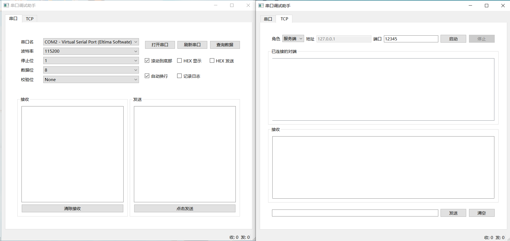

# SerialScope · Qt/C++ 串口 & TCP 调试助手

基于 Qt 6 / C++17 的双通道调试工具。串口与 TCP 各自运行在独立线程，界面不阻塞；串口收发同时支持落盘日志与 MySQL 入库，并提供按时间区间 / 方向 / 条数的数据查询面板；TCP 支持服务端与客户端双模式、多对端连接管理。

## 功能

**串口通信**
- 自动枚举本机串口，显示 `COMx - 设备描述`，可手动刷新
- 参数可配：波特率 9600 / 19200 / 38400 / 57600 / 115200，数据位 5–8，校验 None / Even / Odd，停止位 1 / 2
- 文本与 HEX 两种发送模式：
  - 文本模式：按本地编码（GBK）发送并自动追加 `\r\n`
  - HEX 模式：发送前做正则校验（只允许 `0-9 A-F` 与空白）与偶数长度校验，非法输入直接拦下并在状态栏提示
- 接收区支持文本 / HEX 显示一键切换，可开关自动换行与滚动到底部，接收区最多保留 5000 块历史
- 状态栏实时显示累计收 / 发字节数
- 串口打开期间锁定参数区，避免运行中改配置

**TCP 通信**
- 服务端 / 客户端双模式：服务端监听本机所有网卡；客户端连接指定主机与端口（服务端模式下主机输入框自动置灰）
- 服务端支持多对端接入，对端列表按连接信息增删，状态栏实时显示当前连接数
- 服务端发送为**广播**：一帧数据写给所有在线对端；已断开的连接自动跳过
- 端口号合法性校验（1–65535），客户端模式强制要求填写主机地址
- 对端断开后按连接信息精确移除列表行，重复上报幂等，不会误删或残留
- 收发区最多保留 5000 块历史，可一键清空

**日志与数据库（当前作用于串口通道）**
- 日志落盘：可自选保存路径，每行带毫秒级时间戳与方向标记（`RX` / `TX` / `SYS` / `ERR`）
- MySQL 入库：收发数据与系统事件（打开 / 关闭串口、设备掉线等）写入 `serial_log` 表
- 查询面板：按时间区间（毫秒精度）+ 方向（全部 / TX / RX / 事件）+ 条数上限（100 / 500 / 1000 / 5000）组合查询，表格展示并回显命中条数与查询耗时

> TCP 通道目前只做收发显示，不落盘、不入库。原因是最初的日志层直接实现在串口 worker 内，与串口逻辑耦合；TCP 直接复用会撞上两个问题：`QSqlDatabase` 连接无法跨线程共享（连接名全局唯一），以及逐条 `INSERT` 在 TCP 高吞吐下会阻塞 worker 线程。计划是把日志与入库抽成独立的公共数据层（带批量缓冲），供两个通道共用。

**健壮性**
- 五类异常统一上报到状态栏：串口打开失败、发送失败、设备意外拔除（`ResourceError`）、日志写入失败、数据库错误；TCP 侧另含启动失败、发送失败
- 配置持久化：串口参数在窗口关闭时写入 `config.ini`，下次启动自动恢复
- Debug 构建下启用 CRT 调试堆泄漏检查

## 技术要点

| 要点 | 实现 |
|---|---|
| 线程模型 | `SerialWorker` / `TcpWorker` 均通过 `moveToThread` 移入独立 `QThread`，串口读写、TCP 收发、文件 / 数据库 IO 全部在子线程；UI 与 worker 之间只用信号槽通信 |
| 跨线程通信 | `SerialConfig` / `TcpConfig` 用 `Q_DECLARE_METATYPE` 注册，可经队列连接传递；数据统一走 `QByteArray` |
| 生命周期 | 线程 `finished` → worker `deleteLater`；析构函数中按“串口线程 → TCP 线程”顺序 `quit() + wait()` 保证有序退出 |
| 多对端管理 | 服务端用一个 `QTcpServer` 接受连接，每个对端 `QTcpSocket` 独立挂信号；对端身份存于 `QListWidgetItem` 的 `UserRole`，断线时按身份精确查找并删除 |
| 数据一致性 | 收发计数、日志行、入库记录由同一处逻辑产出，避免三套计数对不上 |
| 数据库 | QODBC 驱动连接 MySQL，查询侧复用连接句柄，避免重复 `addDatabase` |

## 环境要求

- Windows 10/11 x64
- Visual Studio 2022（MSVC v143）
- Qt 6.7.3 msvc2022_64，需包含 **Serial Port**、**Network** 与 **Sql** 模块
- Qt VS Tools 扩展（工程为 `.vcxproj` 形式）
- MySQL 服务 + MySQL ODBC 驱动（开发环境使用 26.7 Unicode Driver）
- 中文界面，源码为 UTF-8 with BOM

## 构建

1. 用 VS2022 打开 `SerialScope.sln`
2. 选择 `Debug|x64` 或 `Release|x64`，生成解决方案
3. 若 Qt 路径与本机不一致：项目属性 → Qt Project Settings → 重新指定 Qt Installation，并确认 Qt Modules 勾选了 `serialport`、`network` 与 `sql`
4. Release 产物如需脱离 VS 运行，用 `windeployqt --release SerialScope.exe` 补齐依赖

## 数据库准备

程序运行不强制依赖数据库（连接失败仅提示，不影响串口收发），但要启用入库与查询面板需要先建库建表：

```sql
CREATE DATABASE IF NOT EXISTS serial_db DEFAULT CHARSET utf8mb4;

CREATE TABLE IF NOT EXISTS serial_log (
    id         BIGINT       NOT NULL AUTO_INCREMENT,
    `time`     DATETIME(3)  NOT NULL,
    direction  VARCHAR(8)   NOT NULL,   -- RX / TX / SYS / ERR
    hex_data   TEXT         NOT NULL,
    byte_count INT          NOT NULL DEFAULT 0,
    PRIMARY KEY (id),
    KEY idx_time ( `time` )
) ENGINE=InnoDB DEFAULT CHARSET=utf8mb4;
```

连接串在 `DbConfig.cpp` 中，**使用前请把 `PWD=` 后面的 `YOUR_PASSWORD` 换成本机 MySQL 密码**，必要时一并调整 `SERVER` / `UID`。

## 界面

单窗口双页签布局：

- **串口页**：左侧参数区（串口名 / 波特率 / 停止位 / 数据位 / 校验位），中部上为接收区、下为发送区，右侧为串口操作与数据查询按钮、以及 HEX 显示 / HEX 发送 / 自动换行 / 滚动到底部 / 记录日志等开关
- **TCP 页**：顶部为角色选择（服务端 / 客户端）、主机、端口与启动 / 停止按钮；左侧为对端列表，右侧为接收区与发送行
- 底部状态栏显示操作提示与累计收发字节数

两个通道互不影响，页签只切换视图，串口在后台持续收发。



## 目录结构

```
SerialScope/                    Git 根目录
├── SerialScope.sln
├── .gitignore
├── README.md
└── SerialScope/                源码目录
    ├── main.cpp
    ├── SerialScope.h/.cpp/.ui  主窗口：界面逻辑、配置读写、双线程装配
    ├── SerialWorker.h/.cpp     子线程：串口收发、日志落盘、MySQL 入库
    ├── TcpWorker.h/.cpp        子线程：TCP 服务端 / 客户端、多对端管理
    ├── QueryDialog.h/.cpp/.ui  数据查询面板
    └── DbConfig.h/.cpp         数据库连接串
```

## 运行须知

- 文本收发按本地编码（GBK）处理，与 UTF-8 设备通信时中文会不一致，属预期行为
- `config.ini` 与 `log_*.txt` 生成在可执行文件目录，已在 `.gitignore` 中排除
- 调试串口建议配对使用虚拟串口工具（com0com / VSPD），或与真实设备对连
- 调试 TCP 可同时开两份程序互测：一份设服务端监听 `12345`，另一份设客户端连 `127.0.0.1:12345`。注意两份要放在**不同目录**，否则会互相覆盖同目录下的 `config.ini`

## Roadmap

- [x] TCP 通信页签：复用同一套 worker 架构，支持 TCP Client / Server 调试
- [x] 多客户端连接管理
- [ ] TCP 通道的日志与数据库入库（抽公共数据层 + 批量写入）
- [ ] TCP 收发支持 HEX 模式与自动换行开关
- [ ] 定时发送与发送历史
- [ ] HEX 接收按帧自动分组显示
- [ ] 接收区时间戳前缀与清空计数
- [ ] 一键部署包（`windeployqt` + 打包脚本，目前需手动执行）

## 许可

个人学习项目，未附带开源许可。
